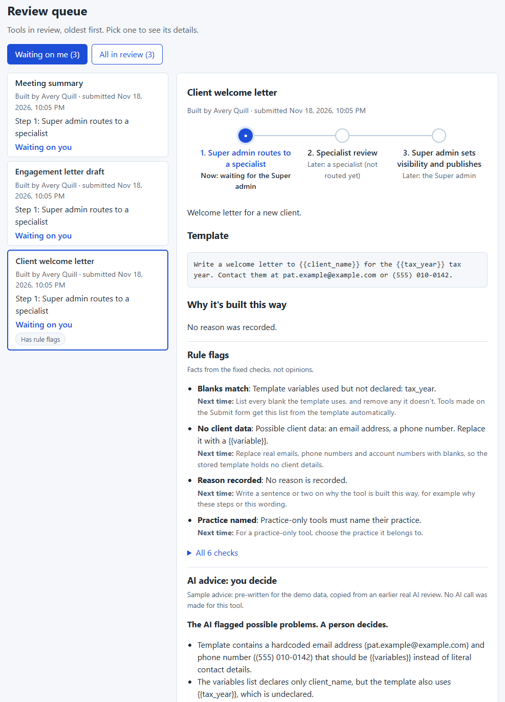
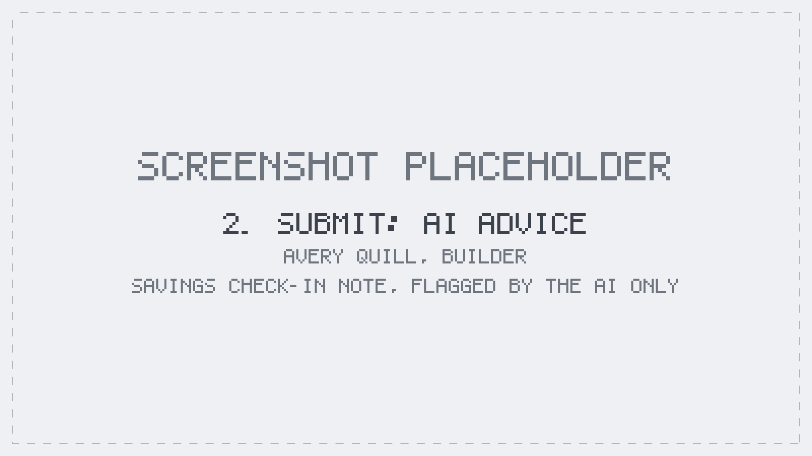
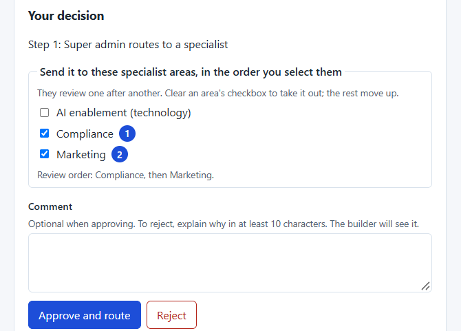
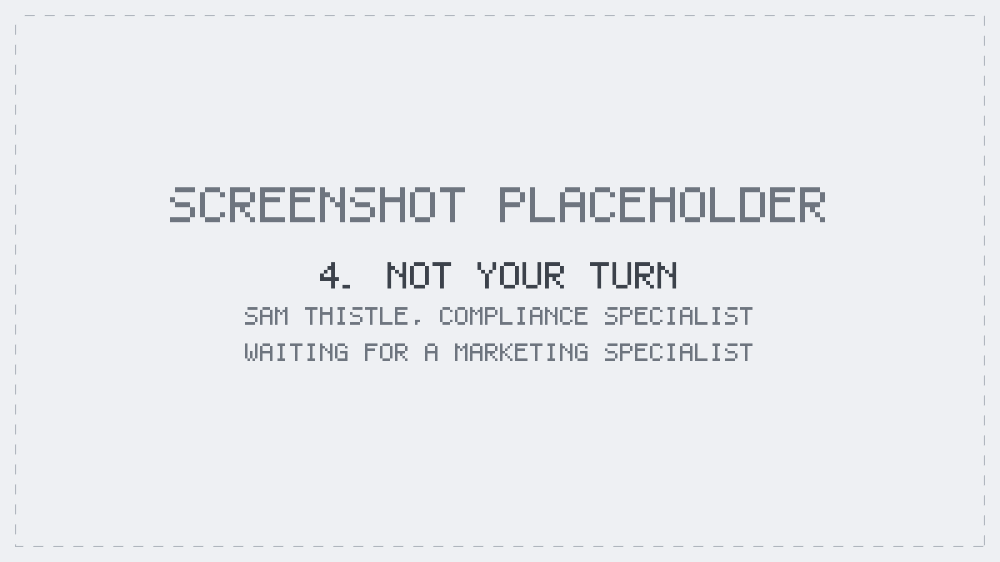
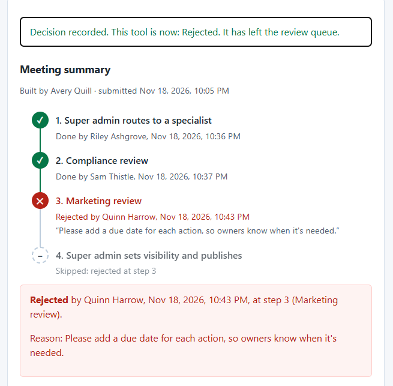
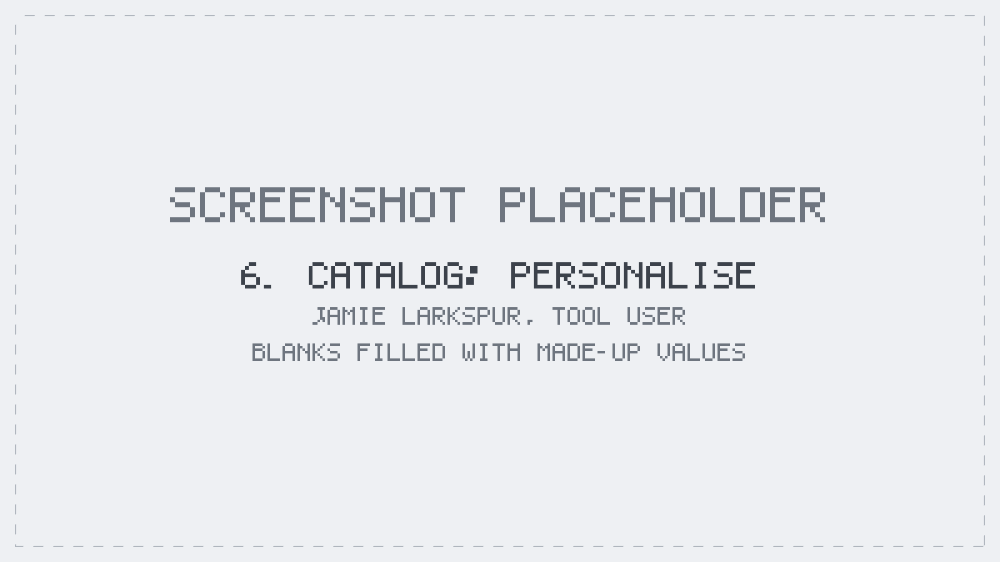

# Tool Registry

**AI tools are spreading through firms faster than the rules for managing them.** Tools reach clients before anyone has checked them, client data leaks out with shared workspaces, teams build the same tool twice, tools are orphaned when their builders leave, and nobody remembers why a template was written the way it was. Tool Registry is one governed catalogue for AI prompt templates: **review once, reuse many times.** A builder submits a template with a short "why I built it this way". Fixed rules check it, an AI pre-review gives advice (it never decides), and people approve it in a set order. Approved tools go into a catalogue, and anyone allowed can fill in the blanks to make their own copy.



> **Demo only.** Every person, client and number is made up. There's no real sign-in: you pick a persona from a dropdown. More detail: [BRIEF.md](BRIEF.md) (problem and goals), [DECISIONS.md](DECISIONS.md) (choices and trade-offs), [EVALS.md](EVALS.md) (AI scores), [REVIEW.md](REVIEW.md) (code review), [BACKLOG.md](BACKLOG.md) (what's next).

---

## How it works

| Step | What happens | Who |
|---|---|---|
| **1. Submit** | The builder fills in a name, description, template with `{{blanks}}`, who can see it (firm-wide or one practice) and a rationale. The blanks are found as they type. A missing rationale is refused. | Builder |
| **2. Rule checks** | Six fixed checks run: blanks match, no client data, reason recorded, owner is current, practice named, unique name. Free, instant, and the same every time. | Automatic |
| **3. AI pre-review** | Claude Haiku 5.5 reads the submission against six risk rules (client data, promised returns, meaningless rationale, tricks aimed at the reviewer, credentials, instructions to leak or hide data) and returns *risky* or *safe*, with issues and a reason. **Advice only:** it never approves, rejects or blocks. If it fails, the tool is marked "needs a human". | AI |
| **4. Approvals** | People approve in a set order (below). They see rule flags and AI advice in separate boxes, so a fixed fact is never confused with an AI opinion. | Admins and specialists |
| **5. Catalog and personalise** | Published tools show their owner, visibility and rationale. "Personalise" asks for each blank and returns a filled-in copy. **The values typed are never saved**, because they may be client details, so stored templates stay clean. | Anyone allowed to see it |

**Flags never block.** A flagged tool still goes to a person, who decides. That follows the brief: anything flagged goes to a human, nothing is auto-rejected.



---

## How approvals work

```
1 Route (Super admin)  →  2 Specialist review(s), in order  →  3 Publish (Super admin)
```

| Rule | What it means |
|---|---|
| **Routing** | The Super admin sends each tool to one or more specialist areas (technology, compliance, marketing), in the order they pick. Each area becomes its own step on the tool's progress bar. |
| **No self-approval** | Nobody approves or rejects a tool they own, admins included. |
| **A different person each step** | Each specialist must be someone who decided no other step of that tool. |
| **Rejections need a reason** | A rejection is final, so it needs a comment of at least 10 characters. The builder sees who rejected it, when, at which step and why. |
| **Least privilege** | Specialists see a tool only while it waits for their area, or after they've decided a step of it. Practice admins see only their own practice's tools. Tool users can't submit. |
| **The back end decides** | Every rule lives in the server and is tested in Python. The screens only show the choices they're given, and the server's own plain-English reason when someone can't act ("You built this tool, so you can't approve or reject it."). |

| | |
|---|---|
|  |  |
|  |  |

---

## How I evaluate the AI

**The test set:** 36 made-up submissions (19 risky, 17 safe), each labelled by hand before the AI saw it. They include deliberately hard cases: a single client name mentioned in passing, a soft promise ("will comfortably outpace inflation"), tricks hidden in a variable name or a polite note to "automated reviewers", a role-play trick, and safe cases built to *look* risky ("we cannot guarantee returns").

**Strict scoring:** every case runs 3 times. A risky case counts as caught only if it's flagged in **all 3** runs, because a risk that slips through once in three would slip through in real use.

### Current score vs the targets in the brief

| Measure | Target | Result (run 5, 108 calls) |
|---|---|---|
| Risky submissions caught | All | **19 / 19** ✅ |
| Safe submissions passed | At least 80% in every run | **94%, 100%, 100%** ✅ |
| Cost per review | Under 1 cent | **$0.0002** on average ✅ |
| Response time | Under 10 s | **1.95 s** on average; one reply ran away to 22 s (see below) |

### What changed, and why

Each change was measured before and after on the same cases.

| Change | Why | Before | After |
|---|---|---|---|
| **Shorter instructions** (same six rules, 394 → 279 words) | Cut cost without losing accuracy. Rule set up front: keep it only if the score stays perfect. | 17/17 risky, 16/16 safe; 1,308 input tokens | **17/17, 16/16; 1,102 tokens (−16%), cost −10%.** Kept. |
| **One sentence: "a missing practice isn't a risk"** | A real review wrongly listed "practice field is null" for a firm-wide tool, which has no practice by design. I reproduced it before changing anything. | Wrong issue in **9 of 10** runs | **0 of 10**; verdicts unchanged; full eval still right on every judged answer |
| **Reply limit 8,000 → 1,000 tokens** | One reply in about 560 calls ran away: 22 s and $0.004 before it was cut off. It was safely sent to a person, but too slow. Normal replies use about 120 tokens. | Worst case 22 s, $0.004 | Worst case about **3 s, $0.0005** (estimated; a test keeps the limit at least twice the longest real reply) |
| **Harder cases added** (20 → 36) | A perfect score on easy cases proves little. Added subtle data, soft promises, disguised tricks, and look-alike safe cases. | | Still caught every risky case |

### Haiku 5.5 vs Sonnet 5.5

Same 34 cases, same instructions, 3 runs each (102 calls per model):

| | **Claude Haiku 5.5** | Claude Sonnet 5.5 |
|---|---|---|
| Score | 18/18 risky, 16/16 safe | 18/18 risky, 16/16 safe |
| Cost per review | **$0.00018** | $0.0035 (about 20× more) |
| Cost per 10,000 reviews | **about $2** | about $35 |
| Average / slowest response | **1.7 s / 3.5 s** | 2.6 s / 6.8 s |

**Why Haiku:** I set the rule before running it: if both score 100%, cost and speed decide. Both did, so Sonnet's extra cost bought nothing I could measure, and Haiku leaves more room under the 10-second target.

**How far to trust it:** I wrote both the cases and the instructions, and a perfect score for both models means the set is too easy to tell them apart. Next steps are trick cases written by a second AI that hasn't seen the instructions, and cases from real reviewer disagreements. If Haiku then misses things Sonnet catches, the plan is a **cascade**: Haiku reviews everything, and Sonnet gives a second opinion on anything flagged.

Full runs, files and caveats: [EVALS.md](EVALS.md).

---

## How I used AI to build it

| Tool | Role |
|---|---|
| **Claude Code** | Built it with me, under written project rules ([CLAUDE.md](CLAUDE.md)): made-up data only, never touch secrets, explain every change in plain language, run the tests after every change. Each phase started with a plan I approved; choices went into DECISIONS.md and deferred work into BACKLOG.md. |
| **OpenAI Codex** | An independent reviewer, run **read-only**: it could read the code and report, not change anything. A different AI is less likely to share the builder's blind spots. |

**The blind test.** While writing Codex's review prompt, Claude spotted 3 possible problems and held them back, so Codex reviewed unsteered. **Codex found 1 of the 3 on its own** (a practice name typo was accepted). It missed the other two: a fragile guard against unknown users, and no length limits on text, which left the cost of an AI review unbounded. All 3 were fixed, one commit each, with a test written first that failed before the fix.

**What I took from it:** a second AI reviewer adds a real check, but neither reviewer is a guarantee. That's why every finding gets a test. Details: [REVIEW.md](REVIEW.md).

---

## How to run it

Needs Python 3.12 or later. On Windows (Git Bash):

```bash
python -m venv .venv
.venv/Scripts/python -m pip install -r requirements.txt
.venv/Scripts/python -m uvicorn registry.api:create_app --factory --reload
```

Open **http://127.0.0.1:8000/** and pick a persona from the "Viewing as" dropdown. The first run creates `registry.db` with sample data; delete it to start fresh. http://127.0.0.1:8000/docs lists every endpoint.

- **No API key needed to look around.** The three sample submissions come with pre-written AI advice copied from a real review and labelled as sample advice, so starting the app makes no AI calls.
- **To see the AI live,** add your own Anthropic API key to `.env`, then submit a tool as Avery Quill (Builder). The sample draft "Savings check-in note" is a good one: it passes every rule check but quietly promises savings "will steadily grow faster than inflation", so any flag comes from the AI.
- **The Catalog starts empty.** Take a sample tool through route → review → publish to see it fill.

### Run the tests

```bash
.venv/Scripts/python -m pytest
```

The tests use a fake AI, so they're free and need no key. To rerun the AI eval (real calls, about $0.02 for all 36 cases × 3 runs):

```bash
.venv/Scripts/python -m evals.run_eval
```

---

## Limits (what this demo isn't)

- **No real sign-in.** You pick who you are from a persona dropdown, which the browser sends as an `X-Persona` header. Anyone could fake that header and act as anyone, so the approval rules are only as safe as the sign-in in front of them. Real use would need proper authentication, with roles from the firm's directory.
- **One machine, one small database.** Data lives in a single SQLite file on the computer running the app. There's no hosting, backups or multi-user setup.
- **Made-up data only.** Every person, client, practice and number is invented. It has never seen real client data.
- **The AI is advice only.** It never approves, rejects or blocks a tool. People make every decision, and a wrong "safe" still meets every human approval step.

---

## What I'd build next

Each item's steps and open questions are in [BACKLOG.md](BACKLOG.md).

### Next

| Item | Why it's next |
|---|---|
| **Real sign-in instead of the persona dropdown** | Every approval rule depends on knowing who's really acting. Until then, none of them can be trusted with real people. |
| **Configurable approval order** | Firms differ in who must sign off. Today the order is fixed, though it's already saved as a list, so this needs no rewrite. |
| **Fix and resubmit after rejection** | Today a rejection is final, so a builder with a fixable problem has to start over. Most rejections should lead to a better tool, not a dead end. |
| **Confirm AI advice** | A specialist selects the AI points they agree with as their reason, recorded as *their* decision, never the AI's. To guard against rubber-stamping (automation bias), each reviewer's agreement rate and decision time are tracked. |
| **Fill blanks from an approved data source** | Typing client details by hand is slow and error-prone. Filling blanks from a firm-approved source, using the person's own access, removes the typing without widening anyone's access. |

### Later

<details>
<summary>The rest of the backlog, by theme (24 items)</summary>

**Keeping people in charge of the AI**
- **Require a reason to approve against the AI's advice:** going against a flag becomes a deliberate, recorded choice, not a click.
- **Make the eval set harder:** trick cases written by a second AI, and cases from real reviewer disagreements.
- **Model cascade:** Haiku reviews everything, and a stronger model gives a second opinion on anything flagged. Only worth it once a harder set shows Haiku missing things.

**Approvals**
- **Hub-and-spoke routing (partly done):** choose the next specialist after seeing each review, not all of them up front.
- **Parallel approvals:** specialists review at the same time, and the tool is published only when all of them approve.
- **Approved outside the registry:** the Super admin records a sign-off given elsewhere, with a reference.
- **Reassign orphaned tools to a new owner:** an admin hands a departed owner's tool to a current user.

**Catalog and tools**
- **Update a published tool:** a change becomes a new version with a full review, and each tool keeps a decision log that's never edited.
- **Practice versions:** a practice adapts a published tool, with review routed by what the change touches.
- **"New" badge on the Catalog tab:** shows how many tools were published since you last looked.
- **Spot overlap:** practices see a summary of what others are building, to avoid building twice.
- **Let anyone propose a tool:** Tool users can submit, and become Builders when they do.
- **Admin-managed practice list:** practices come from a list admins keep, not from what people type.

**Polish and limits**
- **Live character counter on the Submit form and the Review queue's Comment box:** shows how much of each length limit is used as you type.
- **Clearer Comment hint in the Review queue:** put "Required to reject (at least 10 characters)" before "Optional when approving", so people skimming don't miss the rule.
- **Revisit length limits with real data:** today's limits were set from made-up text, so adjust them using real submission lengths.

**Running it for real**
- **Full audit trail for a real firm:** nothing can be deleted or quietly changed, and logs are kept for an agreed time.
- **Notifications:** tell people when a tool reaches their step, and tell builders when it's decided.
- **Ticketing integration:** open a ticket in the reviewer's system and sync the decision back.
- **Browser tests (Playwright):** automated clicks through the real pages as each persona.
- **Move the front end to React:** once there are more screens and more shared pieces.
- **Separate libraries for each practice:** each practice arranges its own library (today: one catalogue with a visibility label).
- **Cost/ROI dashboard:** what the tools cost to run and what they save.
- **Live hosted demo:** a hosted copy to try without installing anything.

</details>
